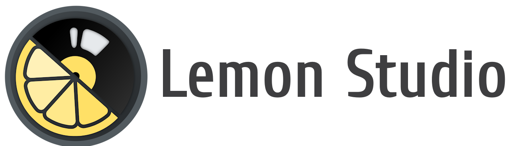
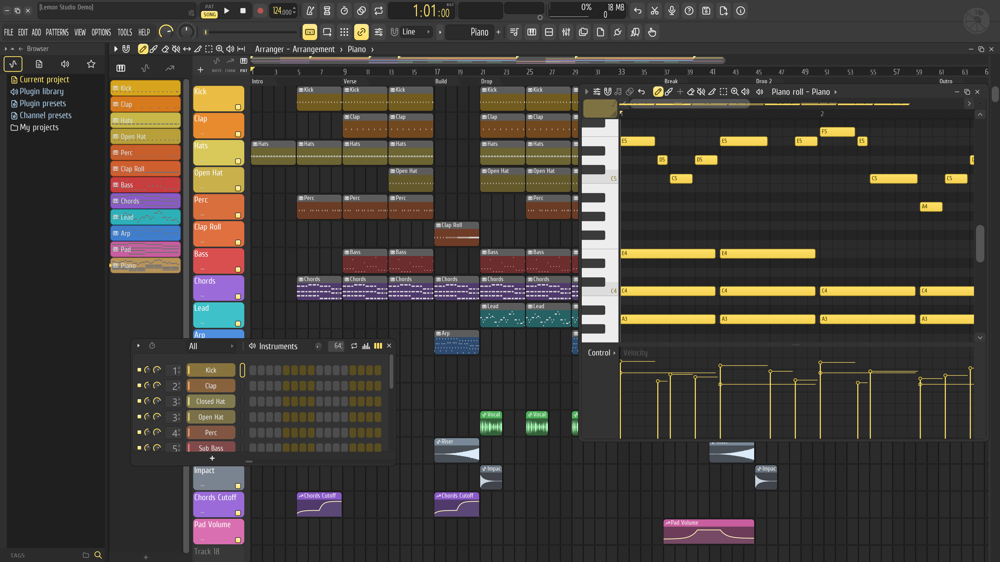
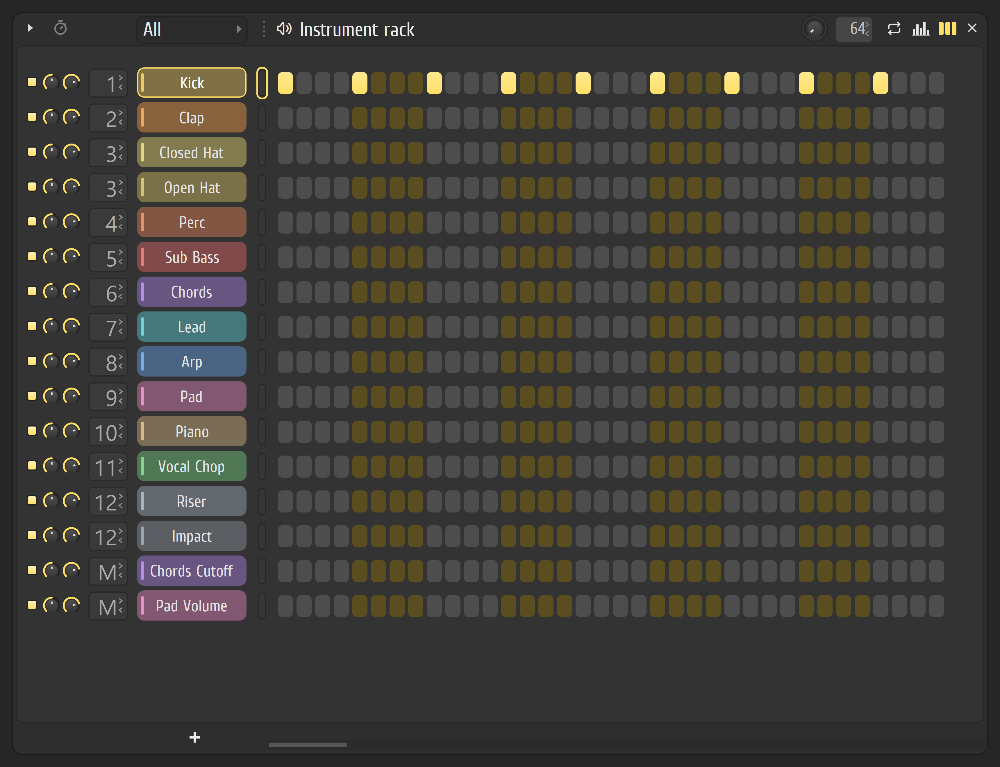
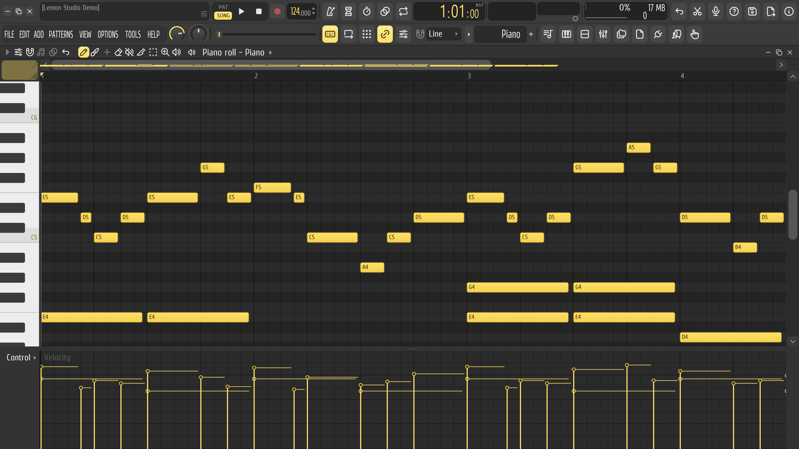
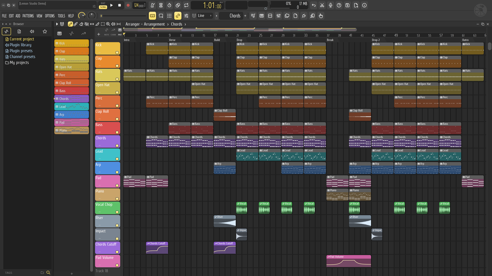
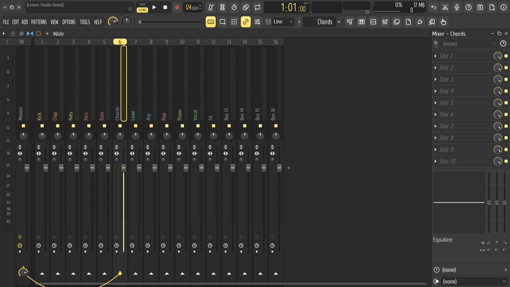

<div align="center">

<picture>
  <source media="(prefers-color-scheme: dark)" srcset="docs/assets/logo-dark.png">
  <source media="(prefers-color-scheme: light)" srcset="docs/assets/logo-light.png">
  
</picture>

<p>A free and open-source digital audio workstation, written in Rust, for Windows, Linux and macOS.</p>

<p>
  <a href="https://github.com/ItsAlphaNeon/Lemon-Studio/actions/workflows/ci.yml"></a>
  <a href="LICENSE"></a>
  
  <a href="https://discord.gg/yC2uCuGs3M"></a>
</p>

<p>
  <a href="https://getlemonstudio.app/"><b>Website</b></a> ·
  <a href="https://getlemonstudio.app/download/"><b>Download</b></a> ·
  <a href="https://getlemonstudio.app/wiki/"><b>Wiki</b></a> ·
  <a href="https://discord.gg/yC2uCuGs3M"><b>Discord</b></a>
</p>

<br>



</div>

---

## What is Lemon Studio?

Lemon Studio is a pattern-based music production program. You build patterns in the instrument rack and piano roll, lay
them out as a song in the arranger, and mix them in the mixer. It comes with its own instruments and effects, and it
loads your CLAP, VST3 and VST2 plugins.

> [!WARNING]
> **Lemon Studio is pre-alpha.** Expect missing features and breaking changes. Greyed-out controls aren't implemented
> yet. Keep backups of anything you care about.

## Features

- **Instrument rack.** Click steps to make a beat, with per-instrument loops, swing and mini piano rolls.
- **Piano roll.** Draw notes, edit velocity and other controls in lanes, and quantize, chop, strum, arpeggiate or
  randomize them.
- **Arranger.** Paint pattern, audio and automation clips, mark sections, keep several arrangements in one project, and
  launch clips live in performance mode.
- **Mixer.** Route any track to any other, stack effects in slots and feed sidechains, with plugin delay compensation
  keeping everything in time.
- **Automation.** Automate instrument, mixer and plugin controls with clips, or record your moves into a pattern.
- **Recording and audio editing.** Record notes and audio, and edit audio in Tesla, the built-in audio editor.
- **Time stretching.** Fit samples and audio clips to the project's tempo.
- **Export.** Render the song, a pattern or stems to WAV, FLAC, MP3 and OGG at once. MIDI files import and export too.
- **MIDI controllers.** Link knobs, faders and plugin controls to your hardware with MIDI learn.
- **Themes.** Pick from 25 built-in themes or make your own.

<table>
  <tr>
    <td width="50%"><a href="docs/assets/screenshot-instrument-rack.webp"></a></td>
    <td width="50%"><a href="docs/assets/screenshot-piano-roll.webp"></a></td>
  </tr>
  <tr>
    <td align="center"><sub>Instrument rack</sub></td>
    <td align="center"><sub>Piano roll</sub></td>
  </tr>
  <tr>
    <td width="50%"><a href="docs/assets/screenshot-arranger.webp"></a></td>
    <td width="50%"><a href="docs/assets/screenshot-mixer.webp"></a></td>
  </tr>
  <tr>
    <td align="center"><sub>Arranger</sub></td>
    <td align="center"><sub>Mixer</sub></td>
  </tr>
</table>

### Built-in plugins

Lemon Studio has 29 plugins built in. All but Lemon MIDI Out and Lemon Container also work as free VST3 and CLAP plugins
in other DAWs. The [catalogue](https://getlemonstudio.app/instruments-and-effects/) says what each one does.

| Kind | Plugins |
|---|---|
| Instruments | Lemon Sampler, Lemon Trio, Citrus, Smith, Lemon Slicer, Lemon Drum Sampler |
| Effects | Lemon Parametric EQ, Lemon Limiter, Lemon Reverb, Lemon Delay, Lemon Chorus, Lemon Flanger, Lemon Phaser, Lemon Filter, Lemon Vocoder, Lemon Soft Clipper, Lemon Fast Distortion, Lemon Transient Processor, Lemon Balance, Lemon Stereo Enhancer, Lemon Stereo Shaper, Pulp Filter, Press, Lemon Drop |
| Controllers | Lemon Peak Controller, Lemon Formula Controller |
| Tools | Tesla, Lemon MIDI Out, Lemon Container |

### Project files

Lemon Studio saves projects as `.lemon` files, its own format. It can also open `.flp` projects saved by FL Studio 10 and
later and convert them to `.lemon`. Saving never touches the original file, and anything Lemon Studio doesn't understand
yet is kept, not thrown away. This support is still young, so work on copies. See
[Project files](https://getlemonstudio.app/wiki/reference/project-files/).

## Status

✅ works · 🚧 partly works

| Area | Status | Still missing |
|---|:---:|---|
| Instrument rack | 🚧 | Arpeggiator, echo delay, gate, time shift and tracking |
| Piano roll | 🚧 | Note colours, scale and chord helpers, sound for release velocity |
| Arranger | 🚧 | Per-clip pitch, pan and reverse. Bars are always 4 beats. Consolidate and exporting all tracks leave plugins out |
| Mixer and routing | ✅ | Other mixer layouts |
| Plugin hosting | ✅ | 32-bit plugins, Audio Units, outputs past a plugin's main stereo pair |
| Built-in plugins | 🚧 | Some settings of the larger plugins aren't played yet |
| Automation | 🚧 | Editing a clip's targets, making controller links in the app |
| Recording | 🚧 | Loop recording and take lanes for audio |
| Audio editing (Tesla) | ✅ | |
| Time stretching | ✅ | |
| Audio and MIDI export | ✅ | |
| MIDI controllers and sync | ✅ | Device scripts, typed mapping formulas |
| Project files | 🚧 | Stable `.flp` support |
| Undo | 🚧 | Step parameters |
| Settings and themes | 🚧 | A few settings are greyed out or have no effect yet |

The area-by-area details are in [docs/status.md](docs/status.md).

## Get Lemon Studio

| System | You need | Audio |
|---|---|---|
| Windows | Windows 10 or 11, x64 | WASAPI, ASIO |
| Linux | x64, on X11, or on Wayland through XWayland | PulseAudio or PipeWire, ALSA, JACK (not yet tried against a running server) |
| macOS | macOS 11 or newer. Downloads are for Apple silicon | Core Audio |

Every change is built and tested on all three.

### Download

**No builds have been released yet.** The first ones are coming soon, and they'll be on the
[download page](https://getlemonstudio.app/download/). They update themselves, but they aren't signed, so your system may
stop them the first time. The [install guide](https://getlemonstudio.app/wiki/getting-started/install/) says how to open
them.

### Build from source

You need [Rust](https://rustup.rs/) (stable, 1.89 or newer) and a few system packages. The
[build guide](https://getlemonstudio.app/wiki/reference/build-from-source/) lists them for each system, and also shows how
to install Lemon Studio with its icon and menu entry.

```bash
git clone https://github.com/ItsAlphaNeon/Lemon-Studio.git
cd Lemon-Studio
cargo run -p os-app --release
```

The first run takes a while. It also builds Lemon Studio's plugins and installs them as VST3 and CLAP plugins for your
other DAWs. A copy built from source never updates itself: to update it, run `git pull` and build it again.

### Learn to use it

Start with the [getting started guide](https://getlemonstudio.app/wiki/getting-started/), or look something up in the
[wiki](https://getlemonstudio.app/wiki/).

## Plans

### The first alpha

✅ done · 🚧 in progress · ⏳ not started

| Step | Status |
|---|:---:|
| Self-updating builds, and nightly builds with their own name and icon | ✅ |
| HELP menu that opens the website and wiki | ✅ |
| Stop plugin crashes from closing Lemon Studio on macOS and Linux (done on Windows) | 🚧 |
| Decide which gaps found by the recent audit hold up the alpha, such as the arranger's fixed 4-beat bars | ⏳ |
| Publish the first nightly builds | ⏳ |
| Tag `v0.1.0`, the first alpha | ⏳ |

Nightly builds come first. Tagged releases follow once the [alpha checklist](docs/alpha-checklist.md) is done. Every
`0.x` release is an alpha, and `v1.0.0` will be the first stable release.

### After the alpha

- The arpeggiator, echo delay, gate, time shift and tracking.
- Glides for plugin instruments, and more automation targets.
- Free routing between the plugins inside a Lemon Container.

The item-by-item roadmap is on the [Discord server](https://discord.gg/yC2uCuGs3M).

## Community and contributing

Join the [Discord server](https://discord.gg/yC2uCuGs3M) to follow development and talk about the project. Support isn't
offered at this stage, but you can [report a bug](https://github.com/ItsAlphaNeon/Lemon-Studio/issues/new/choose).

Lemon Studio isn't accepting outside contributions yet. Once it does, all contributions must be **clean-room** work:
decompiled code, and code or pseudocode derived from decompiled output, won't be accepted in any form.

Lemon Studio is developed independently. File-format and behaviour details needed for interoperability are first written
down as specifications, and the code is implemented from those specifications and public documentation. All artwork,
icons and interface graphics are original or come from openly licensed projects.

Tests, the code layout, command-line tools and scripting are covered in [docs/development.md](docs/development.md).

## License

Copyright (C) 2026 ItsAlphaNeon and the Lemon Studio contributors. Each source file names its copyright holders in its
header.

Lemon Studio is free software: you can redistribute it and/or modify it under the terms of the
[GNU General Public License](LICENSE), version 3 or (at your option) any later version. A Windows build includes the ASIO
SDK under its GPLv3 option, so that build is GPLv3. Lemon Studio is distributed in the hope that it will be useful, but
WITHOUT ANY WARRANTY; without even the implied warranty of MERCHANTABILITY or FITNESS FOR A PARTICULAR PURPOSE. See the
GNU General Public License for more details.

Third-party components keep their authors' copyright and licences. Their notices are in
[THIRD-PARTY-NOTICES.txt](THIRD-PARTY-NOTICES.txt), which goes with every copy of Lemon Studio.

**A request, not a licence term.** As the author, I'd ask that Lemon Studio's code not be used in ArtCraft. This is only
a request: it is not part of Lemon Studio's licence, adds no condition to the GPL, and takes away none of the rights the
GPL gives you.

## Trademarks

FL Studio is a trademark of Image-Line Software. Lemon Studio is an independent project and is not affiliated with,
sponsored by or endorsed by Image-Line Software. FL Studio and its `.flp` file format are referred to solely to describe
interoperability.


VST and ASIO are registered trademarks of Steinberg Media Technologies GmbH. All other trademarks are the property of
their respective owners.
