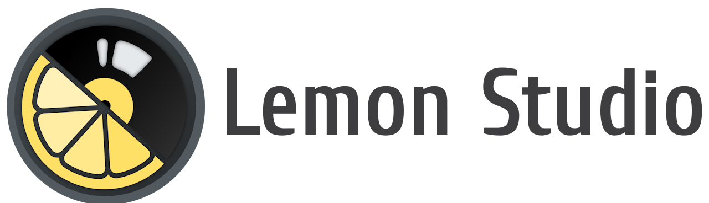
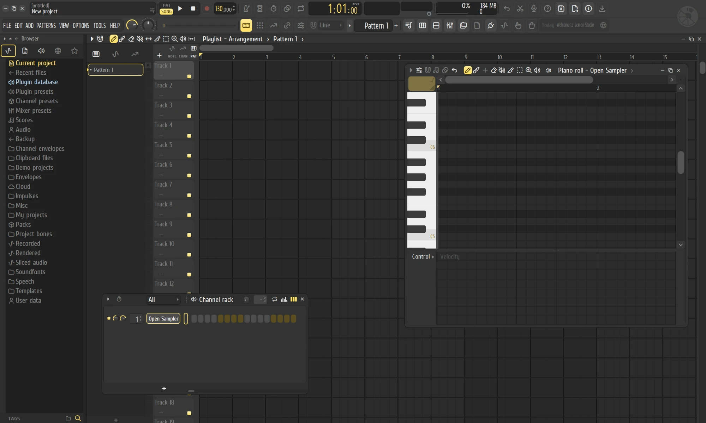
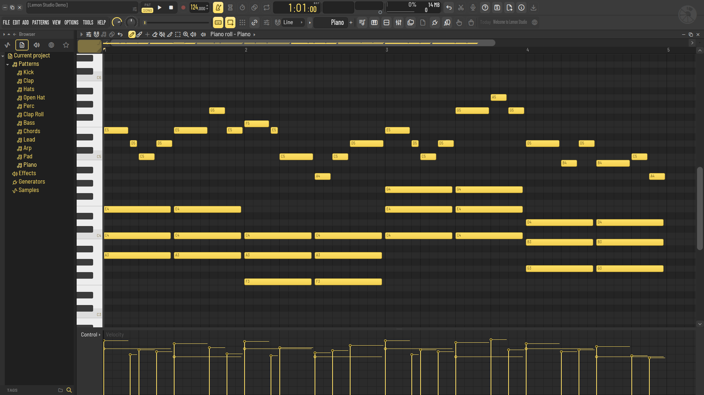
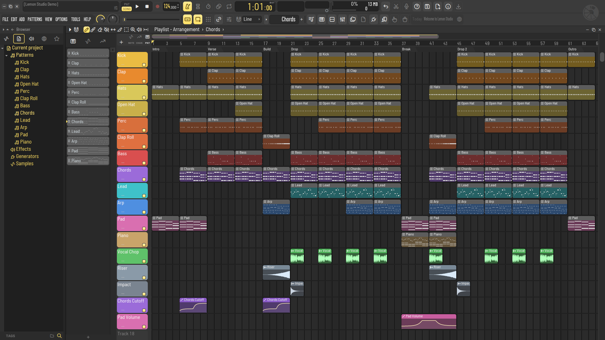
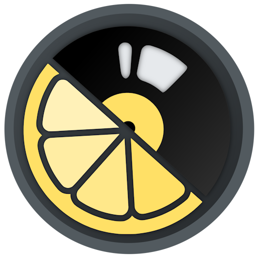

<div align="center">

<picture>
  <source media="(prefers-color-scheme: dark)" srcset="docs/assets/logo-dark.png">
  <source media="(prefers-color-scheme: light)" srcset="docs/assets/logo-light.png">
  
</picture>

<h3>A free and open-source digital audio workstation, written in Rust.</h3>

<p>
  <a href="https://github.com/ItsAlphaNeon/Lemon-Studio/actions/workflows/ci.yml"></a>
  <a href="LICENSE"></a>
  
  
  
  <a href="https://discord.gg/yC2uCuGs3M"></a>
</p>

<p>
  <a href="#overview">Overview</a> ·
  <a href="#capabilities">Capabilities</a> ·
  <a href="#getting-started">Getting started</a> ·
  <a href="#architecture">Architecture</a> ·
  <a href="#roadmap">Roadmap</a> ·
  <a href="#contributing">Contributing</a> ·
  <a href="#community">Community</a> ·
  <a href="#license">License</a>
</p>

<br>



</div>

---

## Overview

Lemon Studio is a pattern-based music production environment: build patterns in a step sequencer and
piano roll, arrange them on a playlist, and mix them through a routable mixer. It is written from the
ground up in Rust, with a sample-accurate audio engine, a fast CPU-rendered interface and hosting for
CLAP, VST3 and VST2 plugins.

Lemon Studio runs on Windows, Linux and macOS, and every change is built and tested on all three. macOS is supported
at the same level as Linux; the few differences are listed in the [macOS notes](#macos).

A central goal is **interoperability**: Lemon Studio opens and saves FL Studio projects (`.flp`). The
project reader is built to round-trip: anything in a file that Lemon Studio does not understand yet is
kept and written back unchanged, so a project survives being opened and saved. This support is still
young, so read the warning below before trying it on real work.

> [!WARNING]
> **Lemon Studio is pre-alpha software.** It is under active development and is not yet a usable DAW:
> expect missing features, rough edges and breaking changes.
>
> - **Greyed-out controls are not implemented yet.** Many menus and buttons are already laid out but do
>   nothing so far; they are drawn dim and say "not available yet".
> - **No prebuilt binaries** will be published until Lemon Studio reaches a usable state. Until then it
>   can only be built from source.
> - **Only projects saved by FL Studio 24.2 or later open for now** (25 and 26 included). Older projects
>   are refused with a dialog that explains how to re-save them; support for them is on the roadmap.
> - **Project-file support is at a very early stage.** Do not overwrite your original `.flp` projects
>   with files saved by Lemon Studio until this support is declared stable. Work on copies and keep backups.

## Capabilities

Where Lemon Studio stands against what a complete DAW offers:

| Area | Status | Notes |
|---|:---:|---|
| Step sequencing and patterns | ✅ | Channel rack with steps, mini piano rolls, swing and per-channel loops |
| Piano roll | ✅ | Full tool set, velocity and event lanes, quantize (FL's templates), chop (FL's patterns), randomize (melodies and levels), strum, arpeggiate, flam, claw machine, flip, level scaling, limit, LFO and more |
| Song arrangement | ✅ | Playlist with pattern, audio and automation clips, clip groups, markers and several arrangements |
| Mixing and routing | ✅ | Mixer tracks, sends, effect slots and meters; sidechain inputs for a project's Fruity Limiter slots and for CLAP and VST3 effects |
| Plugin hosting | ✅ | CLAP, VST3 and VST2 instruments and effects with their editors; "Create automation clip" in CLAP and VST3 plugins' own parameter menus; a parameter menu for every plugin parameter (automation clips, controller links, typed and set values); on Windows a crashing plugin is stopped instead of closing Lemon Studio; no 32-bit plugins |
| Plugin management | ✅ | Plugin manager with your own search folders, a crash-safe background scan, favourites and hidden plugins; presets of your own and factory presets, import of `.vstpreset`, `.fxp` and `.fxb` files, and preset files dropped onto a plugin |
| Time-stretching | ✅ | All twelve stretch methods for samples and audio clips, played by one open-source stretcher |
| Playback engine | 🚧 | Renders ahead of the audio device so edits do not cause dropouts; voice limits, cut groups, glides, layer channels; one audio thread for now |
| Automation | 🚧 | Clips for channel, mixer and plugin parameters with every curve shape, their range and their LFO; channel volume and pan moves record into a pattern; not yet recording into automation clips |
| Project files | 🚧 | Opens and saves projects from FL Studio 24.2 and later; older versions are on the roadmap. Keep backups |
| Built-in instruments and effects | 🚧 | Instruments: Lemon Sampler (long samples can play straight from disk), Lemon Trio (three oscillators) and Citrus (a six-operator synth that plays Sytrus patches). Effects: Lemon Parametric EQ (all of FL's quality modes: HQ+, HQ Enhanced, linear phase), Limiter, Reverb, Delay, Chorus, Stereo Shaper, Stereo Enhancer, Balance, Soft Clipper, Fast Distortion, Transient Processor, Filter, Flanger and Phaser, plus Pulp Filter (a pattern-controlled multi-filter) and Press (a multiband maximiser). All built in, and also VST3 and CLAP plugins for other DAWs; a project's Fruity Limiter slots play Lemon Limiter's sound, sidechain included |
| Exporting audio | ✅ | Song, pattern or selection to WAV, FLAC, MP3 and OGG at once; bit depth, sample rate, interpolation, dither, mono, tails, stems and WAV markers; a pattern rendered as an audio clip (Quick render, Render and replace) |
| MIDI file import / export | ✅ | Import into a new project, the open one or a piano roll channel (tracks, channels, tempo changes, time signatures, markers); export a pattern or the song's patterns |
| Note input | 🚧 | Mouse, computer keyboard, MIDI controllers (velocity curves, sustain pedal, pitch bend, aftertouch) and the touch controller; note recording into patterns with loop record, precount and Start on input; step edit |
| MIDI controllers and sync | ✅ | Link any knob, fader or plugin parameter to a controller (or many at once with Multilink); MIDI clock and time code out, external clock in |
| Undo | 🚧 | One history for the whole project, with redo and the browser's History: edits, knobs and faders, the mixer, channels added and deleted, the tempo and project settings, and plugin parameters, those changed in their own windows too |
| Scripting and assistants | 🚧 | Scripts, tests and AI assistants read and edit projects over a local socket, every change undoable; see [docs/control-plane.md](docs/control-plane.md) |
| Audio drivers | 🚧 | WASAPI (shared and exclusive) and ASIO® (output, and inputs for audio recording) on Windows, ALSA (and PipeWire / PulseAudio through it) on Linux, Core Audio on macOS; no JACK yet |
| Platforms | 🚧 | Windows 10 / 11, Linux (X11, and Wayland through XWayland) and macOS 11 or newer; macOS is supported at the same level as Linux |
| Look and themes | 🚧 | Lemon and Citrus (formerly Classic) skins; 25 built-in themes, your own themes and `.flstheme` files colour either skin, with live adjustments and a colour picker; Lemon plugin editors in the Lemon design only |
| Settings | 🚧 | The General, Audio, MIDI, File, Theme, Project and Info pages work; not yet the recording settings |
| Audio recording | 🚧 | Armed mixer tracks record into the playlist at their record source; one-click audio recording into the playlist or the audio editor, from ASIO or system inputs; Tesla records what reaches its mixer slot |
| Audio editing | ✅ | Tesla, the audio editor and recorder after FL's Edison: a mixer effect (and VST3 / CLAP plugin) with markers, regions, destructive edits and tools; a project's Edison slots open in it |
| Plugin delay compensation | 🚧 | Plugins' reported delays and the mixer tracks' latency settings, in playback and exports; the settings can't be edited yet |

✅ usable · 🚧 partial · ❌ not available yet


ASIO is a registered trademark of Steinberg Media Technologies GmbH.

<table>
  <tr>
    <td width="50%"><a href="docs/assets/screenshot-piano-roll.webp"></a></td>
    <td width="50%"><a href="docs/assets/screenshot-playlist.webp"></a></td>
  </tr>
  <tr>
    <td align="center"><sub>Piano roll: chords and a melody with their note names, and the velocity lane below</sub></td>
    <td align="center"><sub>Song arrangement: pattern, audio and automation clips under section markers</sub></td>
  </tr>
</table>

Per-area details are in [docs/status.md](docs/status.md). The full, item-by-item roadmap lives on the
[Discord server](https://discord.gg/yC2uCuGs3M).

## Getting started

No prebuilt binaries are provided at this stage: Lemon Studio is built from source. Each platform below goes from a fresh
machine to Lemon Studio installed with its icon, and Lemon Studio's own plugins installed for any DAW. All three need
**Rust**, stable toolchain 1.89 or newer, installed through [rustup](https://rustup.rs/), and a clone of this repository:

```bash
git clone https://github.com/ItsAlphaNeon/Lemon-Studio.git
cd Lemon-Studio
```

`cargo run -p os-app --release` builds and runs Lemon Studio. Before Lemon Studio starts, it also rebuilds Lemon
Studio's own plugins (Lemon Sampler, Lemon Trio, Lemon Parametric EQ, Lemon Limiter, Lemon Reverb, Lemon Delay, Lemon
Soft Clipper, Lemon Fast Distortion, Lemon Balance, Lemon Stereo Enhancer, Lemon Transient Processor, Lemon Chorus,
Lemon Stereo Shaper, Lemon Filter, Lemon Flanger, Lemon Phaser, Pulp Filter, Press, Tesla and Citrus) and
installs the ones that changed as VST3 and CLAP plugins, in the folders where other DAWs find them. Lemon Studio itself
has every one of them built in and needs no plugin files. A plugin that is new or updated in the repository shows up
in other DAWs at the next run. The first run builds every plugin, which takes
a few minutes more; later runs rebuild only what changed. Set `OPENSTUDIO_NO_PLUGIN_BUILD=1` to skip the plugin build. A
Lemon Studio installed as below builds nothing: after pulling changes, either run the command above once, or build and
install only the plugins with `cargo run -p bundle-plugins -- --install`.

### Windows

Windows 10 or 11, x64.

**Prerequisites**

- The Microsoft C++ build tools that Rust uses (rustup offers them when it installs; otherwise the Visual Studio Build
  Tools with the "Desktop development with C++" workload). They include the Windows SDK, which embeds the application
  icon in the program; without the SDK the build still succeeds, without the icon.
- LLVM, whose libclang generates the time stretcher's and the ASIO SDK's bindings at build time:
  `winget install LLVM.LLVM`. If `libclang.dll` is not in LLVM's default folder, set `LIBCLANG_PATH` to the folder
  that holds it.

**Build and run**

```powershell
cargo run -p os-app --release
```

**Install** `lemonstudio.exe`, with its icon, into `%USERPROFILE%\.cargo\bin`, and give it a Start menu entry (from there
it can be pinned to the taskbar):

```powershell
cargo install --path crates/os-app
$link = (New-Object -ComObject WScript.Shell).CreateShortcut("$env:APPDATA\Microsoft\Windows\Start Menu\Programs\Lemon Studio.lnk")
$link.TargetPath = "$env:USERPROFILE\.cargo\bin\lemonstudio.exe"
$link.Save()
```

**Plugins:** `cargo run -p os-app --release` installs Lemon Studio's plugins in `%LOCALAPPDATA%\Programs\Common\VST3`
and `...\CLAP`, where DAWs find them. To build and install them without starting Lemon Studio, run
`cargo run -p bundle-plugins -- --install`.

**Notes**

- A plugin that crashes is stopped (its slot passes the sound through) instead of closing Lemon Studio.
- Settings, themes and presets live in `%APPDATA%\Lemon Studio`. `OPENSTUDIO_USER_DIR` overrides the folder.
- Plugins are found in `%LOCALAPPDATA%\Programs\Common\{VST3,CLAP}`, `%COMMONPROGRAMFILES%\{VST3,CLAP}` and
  `CLAP_PATH`, plus any folder added in Settings > Plugins. VST2 plugins are found in the folder their installers
  record (`HKEY_LOCAL_MACHINE\SOFTWARE\VST`, `VSTPluginsPath`) and in those of `%PROGRAMFILES%\VSTPlugins`,
  `%PROGRAMFILES%\Steinberg\VSTPlugins`, `%COMMONPROGRAMFILES%\VST2` and `%COMMONPROGRAMFILES%\Steinberg\VST2` that
  exist. 32-bit VST2 plugins cannot be loaded: they are listed as not supported, without being tried.

### Linux

x64, on X11 or a Wayland desktop.

**Prerequisites:** a C++ compiler and libclang (for the time stretcher), the ALSA development files, the Wayland
development files (which Lemon Sampler's file dialogs link against when it is built as a plugin) and `pkg-config`:

```bash
# Debian / Ubuntu
sudo apt install g++ libclang-dev libasound2-dev libwayland-dev pkg-config
# Arch
sudo pacman -S gcc clang alsa-lib wayland pkgconf
# Fedora
sudo dnf install gcc-c++ clang-devel alsa-lib-devel wayland-devel pkgconf-pkg-config
```

For the "save changes?" prompt, `zenity` or KDE's `kdialog` (a stock KDE desktop has the latter).

**Build and run**

```bash
cargo run -p os-app --release
```

**Install** `lemonstudio` into `~/.cargo/bin` (which must be on your `PATH`), with its icon and an entry in the
application menu (the desktop entry also names the icon under native Wayland):

```bash
cargo install --path crates/os-app
install -Dm644 crates/os-app/assets/lemonstudio.png ~/.local/share/icons/hicolor/256x256/apps/lemonstudio.png
install -Dm644 crates/os-app/assets/lemonstudio.desktop ~/.local/share/applications/lemonstudio.desktop
```

**Plugins:** `cargo run -p os-app --release` installs Lemon Studio's plugins in `~/.vst3` and `~/.clap`. To build and
install them without starting Lemon Studio, run `cargo run -p bundle-plugins -- --install`.

**Notes**

Lemon Studio runs on X11, and on Wayland desktops through XWayland. Plugin editors on Linux are X11 windows, and an X11
window cannot sit inside a native Wayland one; with the main window on X11 too, plugin windows dock inside it as on
Windows (or detach, from their window menu). A few things differ from Windows for now:

- **Native Wayland** is used only when there is no X server, or when `OPENSTUDIO_WAYLAND=1` is set. Plugin windows are
  then always separate windows, kept above Lemon Studio while it is the active application; their window menu, Presets
  list and Misc lists do not open, and files cannot be dropped in from a file manager (the windowing library does not
  support it there).
- **Scaling:** under XWayland Lemon Studio follows the X11 scale (`Xft.dpi`). If it looks soft on a fractionally scaled
  Wayland desktop, let X11 applications scale themselves (KDE: Display Configuration > Legacy applications (X11) >
  Apply scaling themselves).
- **Keys** pressed while a plugin's editor has the keyboard focus do not play the typing keyboard yet, and a sample
  dragged from Lemon Studio's browser onto a plugin window does not reach the plugin yet.
- **Lemon Sampler** cannot copy or paste audio through the clipboard yet.
- **Settings, themes and presets** live in `$XDG_CONFIG_HOME/Lemon Studio` (usually `~/.config/Lemon Studio`).
  `OPENSTUDIO_USER_DIR` overrides the folder.
- Plugins are found in `~/.clap`, `/usr/lib/clap`, `/usr/local/lib/clap` and `CLAP_PATH`, in `~/.vst3`,
  `/usr/lib/vst3` and `/usr/local/lib/vst3`, and in `VST_PATH` (else `~/.vst`, `/usr/lib/vst`, `/usr/local/lib/vst` and
  the `lxvst` folders that exist) for VST2, plus any folder added in Settings > Plugins.

### macOS

macOS 11 or newer. macOS is supported at the same level as Linux, with the same features, and
continuous integration builds and tests every change on macOS alongside Windows and Linux.

**Prerequisites:** the Xcode Command Line Tools, which bring the compiler and libclang: `xcode-select --install`. Xcode
itself is not needed (only to regenerate the app icon, see `tools/logo/macos-icon.sh`).

**Build and run**

```bash
cargo run -p os-app --release
```

**Install** Lemon Studio as an app, `Lemon Studio.app` in `~/Applications`, with its icon: it opens from Launchpad,
Spotlight or the Dock (on macOS 26 and later its icon follows the light, dark, tinted and clear icon styles), and the
Finder opens `.flp` projects with it. Without `--install` the app is only written to `target/bundled/`.

```bash
cargo run -p bundle-app -- --install
```

**Plugins:** `cargo run -p os-app --release` installs Lemon Studio's plugins as bundles, signed ad hoc so that Apple
silicon loads them, in `~/Library/Audio/Plug-Ins/VST3` and `.../CLAP`. To build and install them without starting Lemon
Studio, run `cargo run -p bundle-plugins -- --install`.

**Notes**

Plugin windows dock inside the main window as on Windows, or detach (from their window menu) into windows of their own
that stay above Lemon Studio while it is the active application. A few things differ from Windows and Linux:

- **Menu bar:** the window's menus (FILE … HELP) are also in the macOS menu bar, with the same entries.
- **Keys:** Command stands in for Ctrl in every shortcut (Command+S saves), and
  Control+click is a right click. Quit (Command+Q, the menu bar, the Dock) asks about unsaved changes like closing the
  window does.
- **Plugin windows:** a minimized detached window is hidden rather than sent to the Dock; its channel's button brings
  it back. A sample dragged from Lemon Studio's browser onto a plugin window reaches Lemon Sampler only (other plugins
  take dropped files only from the Finder).
- **Microphone:** the first time a mixer track monitors or records an input (the Mac's microphone, an audio
  interface's inputs), macOS asks whether Lemon Studio may use the microphone; System Settings > Privacy & Security >
  Microphone changes the answer. Started from a terminal, macOS asks on the terminal's behalf instead.
- **FL Studio's factory content** (samples that projects name through `%FLStudioFactoryData%`) is found in the newest
  `/Applications/FL Studio *.app`; `OPENSTUDIO_FACTORY` overrides it.
- **Settings, themes and presets** live in `~/Library/Application Support/Lemon Studio`. `OPENSTUDIO_USER_DIR`
  overrides the folder.
- Plugins are found in `~/Library/Audio/Plug-Ins/{CLAP,VST3,VST}`, `/Library/Audio/Plug-Ins/{CLAP,VST3,VST}` and
  `CLAP_PATH`, plus any folder added in Settings > Plugins. Audio Units are not supported. On Apple silicon, plugins
  built for Intel Macs only (common among older VST2 plugins) cannot be loaded; VST2 ones are listed as not supported,
  without being tried.

### Using Lemon Studio

Open a project directly by passing its path:

```bash
cargo run -p os-app --release -- path/to/project.flp
```

Use `FILE > Export audio` (Ctrl+R) to render the song, or the current pattern in PAT mode, to WAV, FLAC, MP3 or OGG files. The same
render runs without a window, hosting the same plugins the app would and without opening an audio device:

```bash
cargo run -p os-app --release -- --render path/to/project.flp out.wav [--rate 48000] [--seconds 30] [--from TICK] [--builtin-only]
```

`--builtin-only` hosts only Lemon Studio's own plugins, for a render that is the same on every machine.
Settings > Theme picks the skin (Lemon, or Citrus, the look formerly called Classic) and the theme; the choice is
remembered.

Lemon Trio and Lemon Parametric EQ were called Lemon 3x Osc and Lemon Parametric EQ 2 before, and earlier all three
plugins were called Open Sampler, Open 3x Osc and Open Parametric EQ 2. They keep their plugin IDs, so sessions saved
with the old names still open with the new plugins. Installing the plugins (by the run from source or
`bundle-plugins --install`) removes bundles installed under the old names; delete any others you copied yourself, or
DAWs will list each plugin twice.

### Tests

```bash
cargo test --workspace
```

Tests that need an audio device are marked `#[ignore]` and run with `cargo test -p os-app -- --ignored`.
Project-file corpus tests run when `OPENSTUDIO_FLP_CORPUS` points to a text file listing `.flp` paths;
project files are never committed to this repository.
The watermark test (`cargo test -p watermark`) checks that every source file opens with its header: a copyright line
for each of its copyright holders, its SPDX licence identifier and the project's name.

### Scripting and assistants

`--control <socket>` lets scripts, tests and AI assistants read and change the open project over a local socket
(JSON-RPC 2.0), and `--serve <socket> [project.flp]` does the same without a window. Each change is an undo step named
after the client; clients can be limited to reading or to proposing changes the user accepts. The protocol and its
commands are in [docs/control-plane.md](docs/control-plane.md).

```bash
cargo run -p os-app --release -- --control /tmp/lemon.sock path/to/project.flp
```

### Command-line tools

| Tool | Purpose |
|---|---|
| `flp-dump` | Print a project file's event stream and verify that it round-trips |
| `os-render` | Render a project or pattern offline to a WAV file with the engine alone (no hosted plugins, so it does not sound like the app; `--render` above does) |
| `os-play` | Play a project through the default audio output |
| `bundle-plugins` | Build Lemon Studio's own plugins as VST3 and CLAP bundles, and optionally install them (`cargo run -p os-app --release` runs it with `--install`) |
| `bundle-app` | Build Lemon Studio as a macOS app, and optionally install it |

## Architecture

Lemon Studio is a Cargo workspace of focused crates:

| Crate | Responsibility |
|---|---|
| [`os-model`](crates/os-model) | Project data model, free of I/O |
| [`os-flp`](crates/os-flp) | Lossless `.flp` event-stream reader/writer and model mapping |
| [`os-engine`](crates/os-engine) | Audio engine: sampler, mixer, routing, effects, envelopes, automation |
| [`os-dsp`](crates/os-dsp) | DSP building blocks: level curve, pan split, gain glides, mixer matrix and equaliser |
| [`os-theme`](crates/os-theme) | Colour palette, skins (Lemon, Citrus), theme files and the HSL adjustment model |
| [`os-ui`](crates/os-ui) | CPU canvas, text rendering and the shared widget kit |
| [`os-app`](crates/os-app) | The `lemonstudio` application: windows, editors, transport |
| [`os-host`](crates/os-host) | Format-neutral plugin hosting layer (CLAP, VST3, VST2) |
| [`os-clap`](crates/os-clap) | CLAP plugin host |
| [`os-vst3`](crates/os-vst3) | VST3 plugin host |
| [`os-vst2`](crates/os-vst2) | VST2 plugin host, on a clean-room description of the interface (no Steinberg SDK) |
| [`os-hostlink`](crates/os-hostlink) | Host link protocol between Lemon Studio and its own plugins |
| [`os-plugkit`](crates/os-plugkit) | Shared editor pieces of Lemon Studio's own plugins |
| [`os-paths`](crates/os-paths) | Where Lemon Studio keeps its settings, themes and presets on each platform |
| [`lemon-sampler`](plugins/lemon-sampler) | Lemon Sampler instrument (VST3 + CLAP) |
| [`lemon-3x-osc`](plugins/lemon-3x-osc) | Lemon Trio instrument (VST3 + CLAP) |
| [`lemon-parametric-eq-2`](plugins/lemon-parametric-eq-2) | Lemon Parametric EQ effect (VST3 + CLAP) |
| [`lemon-limiter`](plugins/lemon-limiter) | Lemon Limiter effect (VST3 + CLAP) |
| [`lemon-reverb`](plugins/lemon-reverb) | Lemon Reverb effect (VST3 + CLAP) |
| [`lemon-delay`](plugins/lemon-delay) | Lemon Delay effect (VST3 + CLAP) |
| [`lemon-small-fx`](plugins/lemon-small-fx) | What the small Lemon effects share: the plugin, its state, the editor and each effect's description |
| [`lemon-soft-clipper`](plugins/lemon-soft-clipper) | Lemon Soft Clipper effect (VST3 + CLAP) |
| [`lemon-fast-distortion`](plugins/lemon-fast-distortion) | Lemon Fast Distortion effect (VST3 + CLAP) |
| [`lemon-balance`](plugins/lemon-balance) | Lemon Balance effect (VST3 + CLAP) |
| [`lemon-stereo-enhancer`](plugins/lemon-stereo-enhancer) | Lemon Stereo Enhancer effect (VST3 + CLAP) |
| [`lemon-transient-processor`](plugins/lemon-transient-processor) | Lemon Transient Processor effect (VST3 + CLAP) |
| [`lemon-chorus`](plugins/lemon-chorus) | Lemon Chorus effect (VST3 + CLAP) |
| [`lemon-stereo-shaper`](plugins/lemon-stereo-shaper) | Lemon Stereo Shaper effect (VST3 + CLAP) |
| [`lemon-filter`](plugins/lemon-filter) | Lemon Filter effect (VST3 + CLAP) |
| [`lemon-flanger`](plugins/lemon-flanger) | Lemon Flanger effect (VST3 + CLAP) |
| [`lemon-phaser`](plugins/lemon-phaser) | Lemon Phaser effect (VST3 + CLAP) |
| [`pulp-filter`](plugins/pulp-filter) | Pulp Filter effect, a pattern-controlled multi-filter (VST3 + CLAP) |
| [`press`](plugins/press) | Press effect, a multiband maximiser (VST3 + CLAP) |
| [`tesla`](plugins/tesla) | Tesla, the audio editor and recorder (VST3 + CLAP) |
| [`citrus`](plugins/citrus) | Citrus instrument, a six-operator synthesizer (VST3 + CLAP) |

## Roadmap

The roadmap is kept on the [Lemon Studio Discord server](https://discord.gg/yC2uCuGs3M), where every item is
marked as complete, in progress or not started. The broad next steps are the engine rework (sampler voice,
automation), opening projects from older FL Studio versions, more built-in instruments and effects, and the rest of
the plugin window features on Linux.

## Development approach

Lemon Studio is developed independently. File-format and behaviour details needed for
interoperability are first written down as specifications, and the product code is implemented
from those specifications and public documentation. All artwork, icons and interface graphics
in this repository are original or come from the openly licensed projects listed below.

## Contributing

Lemon Studio is not accepting outside contributions yet. Once it does, pull requests will be welcome
from developers who are comfortable with Rust and the pull-request workflow.

All contributions must be **clean-room** work. Decompiled code, and code or pseudocode derived from
decompiled output, will not be accepted in any form: the codebase must contain none of it.

Contributors keep the copyright of their work and license it under the GPL, version 3 or later, like the rest of
Lemon Studio. In each file you write or substantially change, add a line with your name or username to the copyright
lines at the top of the header, `Copyright (C) <year> <name>`, and keep the lines already there.

## Community

Join the [Lemon Studio Discord server](https://discord.gg/yC2uCuGs3M) to follow development and talk
about the project. Please keep in mind that support is not offered at this stage.

## Third-party components

| Component | Use | License |
|---|---|---|
| [Cuprum](https://fonts.google.com/specimen/Cuprum) by Jovanny Lemonad | Interface typeface | [SIL Open Font License 1.1](crates/os-ui/fonts/Cuprum/OFL.txt) |
| [Barlow](https://github.com/jpt/barlow) by The Barlow Project Authors | Interface typeface on Linux and macOS | [SIL Open Font License 1.1](crates/os-ui/fonts/Barlow/OFL.txt) |
| [Tabler Icons](https://tabler.io/icons) | Interface icons | [MIT](crates/os-ui/icons/TABLER-LICENSE.txt) |
| [NIH-plug](https://github.com/robbert-vdh/nih-plug) | Plugin framework for Lemon Studio's plugins | ISC |
| [vst3-sys](https://github.com/RustAudio/vst3-sys) | VST3 interface bindings (plugin hosting and Lemon Studio's plugins) | GPLv3 or later (its com crate MIT) |
| [vst2sdk](https://github.com/Xaymar/vst2sdk) by Xaymar | Clean-room description of the VST2 interface, which `os-vst2`'s bindings are written from | [BSD 3-Clause](crates/os-vst2/LICENSE-vst2sdk.txt) |
| [FST](https://git.iem.at/zmoelnig/FST) by IOhannes m zmölnig | Reverse-engineered VST2 interface: the parts vst2sdk leaves out (time info, edit gestures) | GPLv3 or later |
| [Signalsmith Stretch](https://github.com/Signalsmith-Audio/signalsmith-stretch) by Geraint Luff / Signalsmith Audio Ltd, with Signalsmith Linear | Time stretching and pitch shifting | MIT |
| [signalsmith-stretch](https://github.com/colinmarc/signalsmith-stretch-rs) by Colin Marc | Rust bindings to Signalsmith Stretch | MIT |
| [ASIO SDK](https://www.steinberg.net/asiosdk) by Steinberg Media Technologies GmbH (host files) | ASIO output on Windows | [GPLv3](crates/os-app/asiosdk/LICENSE.txt) (its GPL option); a Windows build with it is GPLv3 |
| [Cantarell](https://gitlab.gnome.org/GNOME/cantarell-fonts), built into the sctk-adwaita crate | Window title bars on Wayland (Linux) | SIL Open Font License 1.1 |
| [LAME](https://lame.sourceforge.io) 3.100, built by the mp3lame-sys crate | MP3 export | LGPL version 2 or later |
| Rust crates listed in `Cargo.lock` | Various | Their respective licenses |

Their copyright notices and licence texts are collected in [THIRD-PARTY-NOTICES.txt](THIRD-PARTY-NOTICES.txt), which
goes with every copy of Lemon Studio next to [LICENSE](LICENSE). Its last section, the Rust crates with their licence
texts, is generated by `cargo run -p notices` (with [cargo-about](https://github.com/EmbarkStudios/cargo-about):
`cargo install cargo-about --locked --features cli`); `cargo test` fails while a crate that goes into a build is missing
from it, so run it after changing a dependency.

ASIO is a registered trademark of Steinberg Media Technologies GmbH.

## License

Copyright (C) 2026 ItsAlphaNeon and the Lemon Studio contributors. Each source file names its copyright holders in
its header.

Lemon Studio is free software: you can redistribute it and/or modify it under the terms of the
[GNU General Public License](LICENSE), version 3 or (at your option) any later version. It is distributed in the hope
that it will be useful, but WITHOUT ANY WARRANTY; without even the implied warranty of MERCHANTABILITY or FITNESS FOR
A PARTICULAR PURPOSE. See the GNU General Public License for more details.

The third-party components listed above keep their authors' copyright and licences, whose notices are in
[THIRD-PARTY-NOTICES.txt](THIRD-PARTY-NOTICES.txt). The two source files that hold others' work
(`crates/os-vst2/src/abi.rs`, `crates/os-ui/src/tabler.rs`) name it in their header.

**A request, not a licence term.** As the author, I'd ask that Lemon Studio's code not be used in ArtCraft. This is
only a request: it is not part of Lemon Studio's licence, adds no condition to the GPL, and takes away none of the
rights the GPL gives you.

## Trademarks

FL Studio is a trademark of Image-Line Software. Lemon Studio is an independent project and is not
affiliated with, sponsored by or endorsed by Image-Line Software. FL Studio and its `.flp` file format
are referred to solely to describe interoperability.

VST is a registered trademark of Steinberg Media Technologies GmbH. All other trademarks are the
property of their respective owners.

<div align="center">
<br>

<br>
<sub>Copyright © 2026 ItsAlphaNeon and the Lemon Studio contributors. Free software under the GNU GPL, version 3 or later.</sub>
</div>
